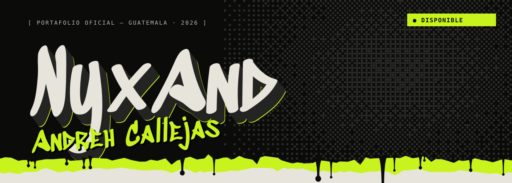
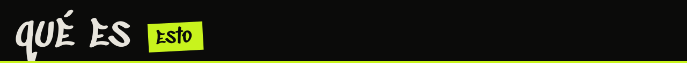
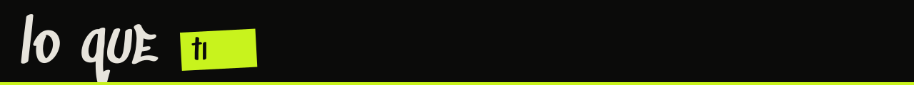
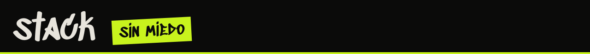
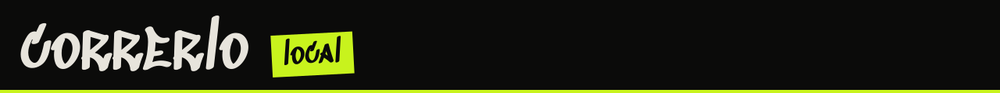
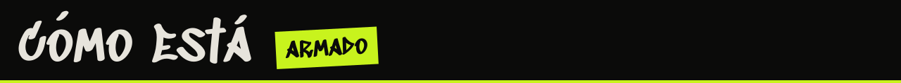
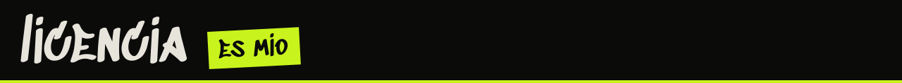

<p align="center">
  
</p>

<p align="center">
  <b>Portafolio oficial de Dereck Andreh Callejas Ajin — NyxAnd.</b><br />
  Desarrollador de software · Guatemala · <a href="https://nyxand.site">nyxand.site</a>
</p>

<p align="center">
  
</p>



Este es mi portafolio oficial. No es una plantilla: está hecho a mano, efecto por efecto, con una dirección visual urbana y brutalista que mezcla **1-bit, graffiti y pintura que chorrea**, en monocromo con un solo acento lima.

La idea es simple: que el sitio en sí demuestre lo que sé hacer. WebGL, shaders, física de pintura, tipografía convertida a 3D y animaciones que reaccionan al scroll y al cursor, sin sacrificar accesibilidad ni rendimiento.



| Pieza | Qué hace |
|---|---|
| **Hero 3D** | "NyxAnd" en graffiti extruido de cromo, con piercings, tramado a 1-bit sobre mi foto. La lente del cursor revela el cromo; mantener presionado lo derrite; el scroll lo desintegra en píxeles. |
| **Intro** | Contador mientras carga el 3D, letras que caen con impacto y mi nombre pintado como tag de aerosol. |
| **Tipografía viva** | Los títulos se pintan con spray, se derriten al pasarles el cursor o al hacer scroll rápido y se inclinan con la velocidad. |
| **Cortes rasgados** | Entre secciones la página se rompe y deja ver sticker roto lima y negro, con chorreados que acumulan pintura, bajan por su peso y sueltan gotas. |
| **Proyectos** | Carrete de película en cilindro 3D. Cada caso abre un panel rasgado con lo destacado, stack y enlaces verificados. |
| **Fuera del código** | Carrusel WebGL infinito de fotos personales que se arquea y se derrite al arrastrarlo. |
| **Detalles** | Cursor de aerosol, monito dibujado a mano que cobra vida, barra de progreso que gotea y un easter egg: escribe `nyx`. |

**Calidad.** Accesibilidad, buenas prácticas y SEO en 100 en Lighthouse. Modo liviano automático para teléfonos, equipos con pocos recursos o sin aceleración gráfica. Respeta `prefers-reduced-motion`, funciona con teclado y tiene `noscript`.

**Rendimiento.** El hero renderiza la escena a 70 % de resolución con tope de 60 fps, shaders sin arreglos por píxel, filtros con ruido precalculado, capas de GPU para lo que se transforma con el scroll y todo lo animado en pausa fuera de pantalla.



- **Vite + TypeScript**, sin framework.
- **three.js** + **opentype.js**: texto 3D generado desde la fuente.
- **GSAP** + ScrollTrigger y **Lenis** para el movimiento.
- **Tipografías**: Sedgwick Ave Display, JetBrains Mono y Anton (Google Fonts), Jacquard 24 (Fontsource).
- **Vercel** para el despliegue.



```bash
npm install
npm run dev        # http://localhost:5173
npm run build      # build de producción en /dist
npm run preview    # sirve el build en http://localhost:4173
```

Los SVG de este README se generan con mi tipografía convertida a trazos:

```bash
node scripts/readme-assets.mjs
```



```
├── index.html            secciones, metadatos y filtros SVG
├── vercel.json           build, caché y cabeceras de seguridad
├── public/               fotos, capturas, CV, imagen OG, robots y sitemap
├── docs/readme/          SVG de este README
├── scripts/              generador de los SVG del README
└── src/
    ├── main.ts           arranque, intro, scroll y animaciones
    ├── hero3d.ts         hero WebGL (texto 3D + tramado 1-bit)
    ├── photos3d.ts       carrusel WebGL de fotos
    ├── film.ts           carrete de proyectos y panel de caso
    ├── projects.ts       datos de los proyectos
    ├── drips.ts          chorreados de los cortes
    ├── doodle.ts         monito dibujado a mano
    ├── extras.ts         progreso que gotea, panel rasgado, easter egg
    ├── fx.ts             cortes, cursor, spray, derretido y utilidades
    ├── device.ts         detección del modo liviano
    ├── watermark.ts      firma en la consola
    └── style.css         estilos y tokens de diseño
```



**Todos los derechos reservados.** Este repositorio es público solo para que se pueda ver mi trabajo. El diseño, el código, los textos y las fotografías son míos y **no se pueden copiar, reutilizar, modificar ni redistribuir**, total o parcialmente, sin mi permiso escrito. Tampoco se pueden usar para entrenar modelos de IA. Detalles completos en [`LICENSE`](LICENSE).

¿Te gustó y quieres algo así? Hablemos: **andrehcallex@gmail.com**

<p align="center">
  
</p>

<p align="center">
  Diseño y desarrollo: <b>Dereck Andreh Callejas Ajin — NyxAnd</b> · Guatemala · 2026
</p>
